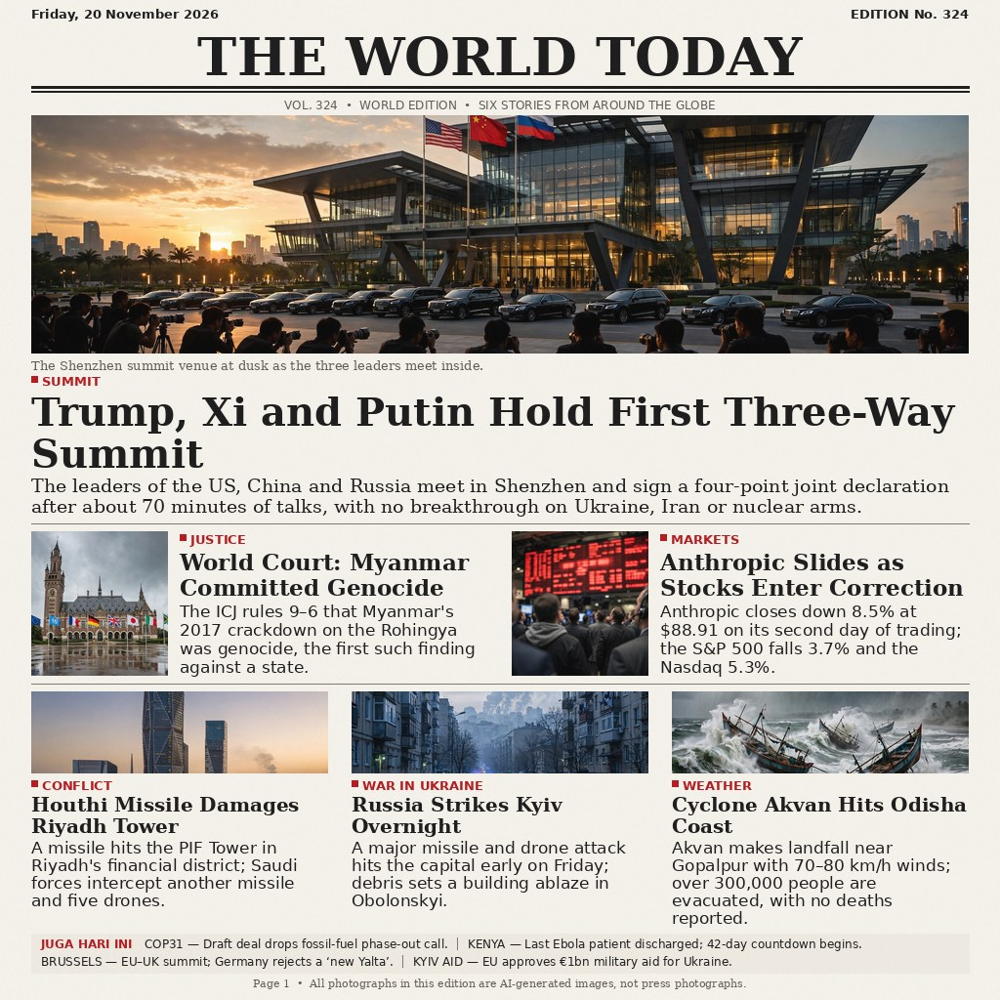

# The World Today — 20 November 2026 in one image

[](https://make.fun/bounty/news-image-20261120)
[](https://make.fun/bounty/news-image-20261120)
[](https://make.fun/bounty/news-image-20261120)

One front page of **THE WORLD TODAY** covering world news from Friday,
20 November 2026 — built for the [make.fun](https://make.fun/bounty/news-image-20261120)
competition **news-image-20261120** ($250, free entry).

The page is a classic newspaper front page (1024×1024, JPEG, under 1 MiB):
a serif masthead with double rules, one large lead story with supporting
stories below, small category kickers, thin divider rules, and a
"JUGA HARI INI" footer strip of one-line briefs. All photographs are
AI-generated images, not press photographs — see the folio line at the
foot of the page.



## The six stories

1. **SUMMIT — Trump, Xi and Putin Hold First Three-Way Summit.** The leaders
   of the US, China and Russia meet in Shenzhen and sign a four-point joint
   declaration after about 70 minutes of talks, with no breakthrough on
   Ukraine, Iran or nuclear arms.
2. **JUSTICE — World Court: Myanmar Committed Genocide.** The ICJ rules 9–6
   that Myanmar's 2017 crackdown on the Rohingya was genocide, the first such
   finding against a state.
3. **MARKETS — Anthropic Slides as Stocks Enter Correction.** Anthropic closes
   down 8.5% at $88.91 on its second day of trading; the S&P 500 falls 3.7%
   and the Nasdaq 5.3%.
4. **CONFLICT — Houthi Missile Damages Riyadh Tower.** A missile hits the PIF
   Tower in Riyadh's financial district; Saudi forces intercept another
   missile and five drones.
5. **WAR IN UKRAINE — Russia Strikes Kyiv Overnight.** A major missile and
   drone attack hits the capital early on Friday; debris sets a building
   ablaze in Obolonskyi.
6. **WEATHER — Cyclone Akvan Hits Odisha Coast.** Akvan makes landfall near
   Gopalpur with 70–80 km/h winds; over 300,000 people are evacuated, with
   no deaths reported.

Also in the footer strip: COP31, Kenya (Ebola), the EU–UK summit in
Brussels, and €1bn of EU military aid for Ukraine.

## How to run

`main.ts` (Node 22+, standard library only) copies the finished front page
next to it into the output directory and writes a canonical build dossier
(`dossier.json`) describing it:

```sh
MAKEFUN_OUTPUT_DIR=/some/dir node main.ts
# entry.png + dossier.json appear in /some/dir
# (when MAKEFUN_OUTPUT_DIR is unset, output goes to /output)
```

The copy is verified byte-for-byte (SHA-256) before the script reports
success. `entry.png` itself is rendered from photorealistic AI-generated
panels composited with PIL (`build_frontpage.py`, kept out of this commit).
